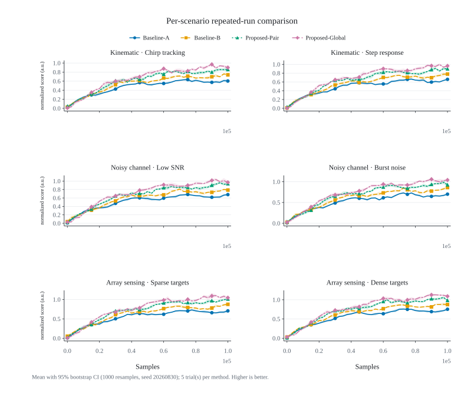

# Signal figure studio

English | [中文](README.zh.md)

**A DeepSeek Harness plugin for the experimental section of signal-processing papers.** Turn repeated-run
logs into publication figures, tune layout and colour on a live preview, iterate in versions, and roll back
at any time.

[](LICENSE)
[](https://github.com/jiesudd/dsh-signal-figure-studio/actions/workflows/checks.yml)
[](https://nodejs.org/)



*Same demo data after the IEEE single-column optimization:
[`examples/scenario-curves-ieee-single.svg`](examples/scenario-curves-ieee-single.svg).*

---

## Why this exists

Signal-processing experiment sections repeat the same five figures: per-scenario curves, a robust aggregate,
an ablation, a sensitivity sweep, and a mechanism plot. Rebuilding them by hand invites the usual defects —
uncertainty that is never disclosed, dB values averaged in the wrong domain, bars drawn from zero for negative
errors, panels that do not share a palette, and "improvements" that cannot be reproduced because the plotting
script was edited in place.

This plugin encodes one evidence chain instead:

- tidy logs are **audited before anything is plotted**;
- statistics are computed once, with a fixed seed, and never from smoothed display data;
- layout and colour are **parameters of a saved spec**, not edits to a script;
- every round is a **version** you can diff, compare, and roll back to;
- the figure is scored against ten acceptance checks from a real paper profile.

## Features

- **Five figure types** — per-scenario curves, aggregate IQM, ablation, sensitivity, mechanism — with the
  right data subset and estimator chosen per type.
- **Live preview** while you drag sliders: canvas size, panel grid, gaps, legend placement, fonts, sizes,
  palettes, per-method colours, line width/dash/markers, confidence bands or error bars, grid and spines,
  log axes, tick counts, scientific notation, metric/unit labels, "lower is better", smoothing window,
  checkpoints, and dB transforms.
- **Nine optimization recipes** — IEEE single column, double column, talk slide, colour-vision safe,
  contrast boost, tighten spacing, enlarge labels, negative-dB fix, display smoothing. Each one saves a
  version.
- **Version history with rollback** — every version carries a note and a field-level diff of what rolling
  back would change; compare two versions side by side, then roll back (which itself becomes a new version,
  so history is never rewritten). Undo/redo covers unsaved edits.
- **Ten-point QA report** — raw-data traceability, replication, disclosed uncertainty, robust aggregation,
  statistical integrity, consistency, legibility, accessibility, reproducibility, evidence coverage; 18/20
  is the publishable bar and the first five may not score zero.
- **Exports** — vector SVG, PNG at the spec's dpi (rasterized from the same SVG), the endpoint summary CSV,
  the spec JSON, and the QA report.
- **One implementation, two callers** — the panel and the `signal_figure_studio` agent tool call the same
  Host service, so a model and a human can never drift apart.

## Requirements

- A DeepSeek Harness (DSH) installation with a profile — Desktop or `dsh web`.
- Node.js ≥ 20 (the DSH runtime ships one; no dependencies are installed for this plugin).
- Git, only if you install from GitHub (the plugin manager checks a GitHub repository with `git ls-remote`).

## Install

Pick whichever route matches how you use DSH. All three install the same bundle into your active profile.

### 1. From the Plugins page (no terminal)

1. In the DSH Web UI sidebar, open **Plugins**.
2. Click **Add plugin**.
3. Paste one of these specs into the package field:

   ```
   github:jiesudd/dsh-signal-figure-studio
   ```

   ```
   https://github.com/jiesudd/dsh-signal-figure-studio
   ```

4. Press **Install**. The dialog first reads what the spec names, then runs pnpm and shows its output.
5. When it finishes, click **Enable now**.
6. If the page was already open, refresh it once. The sidebar panel list then shows
   **Signal figure studio**.

Git must be on `PATH`: the manager runs `git ls-remote` against GitHub before it starts pnpm, so a
machine without Git fails at that check rather than during the download.

### 2. From an agent session

Ask the Harness agent to install it, or call the tool directly:

```
plugin_manager { action: "install_bundle", target: "github:jiesudd/dsh-signal-figure-studio" }
```

### 3. From a checkout (development)

```bash
git clone https://github.com/jiesudd/dsh-signal-figure-studio.git
```

Then install from the absolute path:

```
plugin_manager { action: "install_bundle", target: "<absolute path to the checkout>" }
```

The bundle is linked, not copied, so edits in the checkout take effect after a plugin reload. This route
does **not** need Git on `PATH` at install time beyond the clone itself.

### Requirements at a glance

| Requirement | Why |
| --- | --- |
| A DSH installation with a managed profile | Bundles install into a profile |
| Node.js ≥ 20 | The DSH runtime ships one |
| Git on `PATH` | Only for the GitHub route (`git ls-remote` precheck) |
| Nothing else | The plugin has no dependencies and no install scripts |

### If the GitHub route fails

| Symptom | Cause and fix |
| --- | --- |
| Fails before any download, mentions GitHub | `git ls-remote` could not reach GitHub. The npm mirror option does not help — a mirror serves registry packages, not Git repositories. Use route 3, or upload a `pnpm pack` tarball somewhere reachable and install that path. |
| `already-installed` | A bundle with the same package name is already in the profile. Uninstall it first; reinstalling is how you move between versions. |
| Install succeeds but no panel appears | The page was open across the plugin load. Refresh once. |
| Install succeeds, bundle loads, panel throws | Check the browser console for `slot entry crashed`. Report it with the DSH version. |

> The package name keeps the `@local/` scope, inherited from local development. It installs and resolves
> correctly from GitHub. If you publish to npm instead, change `name` in `package.json` **and** in
> `cordis.patch.yml` together, then reinstall.

## Quick start

1. Click the panel icon in the sidebar.
2. Press **Load demo dataset** to explore with clearly labelled synthetic data, or **Import CSV** to load
   your tidy log.
3. Pick a figure type on the left.
4. Adjust layout and colour on the right — the preview updates as you go.
5. Press **Optimize** for a publication style, **Save version** for your own checkpoint, or **Compare** any
   earlier version, then **Roll back**.
6. Export SVG/PNG plus the summary CSV, spec JSON, and QA report.

## Data contract

Tidy CSV, one observation per row:

```csv
benchmark,scenario,method,seed,step,value,metric,unit,variant,heterogeneity
ANC,Impulse,NLMS,0,0,-15.563,error power,dB,main,
ANC,Impulse,NLMS,0,1000,-14.735,error power,dB,main,
```

| Column | Required | Meaning |
| --- | --- | --- |
| `benchmark` | yes | Benchmark family, used as the panel group for aggregate figures |
| `scenario` | yes | Scenario inside the benchmark, used as one panel |
| `method` | yes | Compared method; colour, dash, and marker follow this order |
| `seed` | yes | Trial identifier (a deterministic substream of one base seed is still a trial) |
| `step` | yes | Ordered x value: samples, iterations, or iterations after an abrupt change |
| `value` | yes | Measured value in the stored domain |
| `metric` | no | Metric name used for the y-axis label |
| `unit` | no | Unit shown in the y-axis label |
| `variant` | no | `main` (default), `ablation`, or `sensitivity`; selects the data subset per figure type |
| `heterogeneity` | no | Measured mechanism variable for the mechanism figure |

Before rendering, the log is audited. These **stop the pipeline** and are reported with line numbers instead
of being dropped silently:

- duplicate `(benchmark, scenario, method, seed, step)` keys;
- non-finite values or steps;
- non-monotone steps inside one run;
- fewer than three trials;
- mixed step grids inside one scenario.

## Figure types

| Type | Use it when | Statistics |
| --- | --- | --- |
| Per-scenario curves | repeated runs on a shared step grid, one panel per scenario | run mean with a 95% bootstrap band |
| Aggregate IQM | multiple scenarios per benchmark, sample efficiency at checkpoints | interquartile mean with a task-stratified bootstrap CI |
| Ablation | a component or strategy factor was actually varied (`variant=ablation`) | per-method mean with a band |
| Sensitivity | a hyperparameter setting was varied (`variant=sensitivity`) | setting curves with the baseline kept distinct |
| Mechanism | a mechanism variable was measured (`heterogeneity`) | mean mechanism value against mean performance |

## Statistical guardrails

- Intervals are percentile bootstrap intervals with a fixed seed and a stated resample count — both printed
  in the figure note.
- Smoothing is causal and **display only**; endpoints and the summary table always come from unsmoothed
  aggregates.
- A power-like metric stored linearly is aggregated in the linear domain and only then converted to dB
  (`10·log10` for power, `20·log10` for amplitude).
- Negative-dB comparisons use curves with intervals; the "lower is better" note is on by default.
- `include zero` is off unless you ask for it, so negative dB ranges are not squashed against zero.

## QA report

| Check | What it inspects |
| --- | --- |
| Raw-data traceability | every plotted point maps back to benchmark, scenario, method, seed, step |
| Replication | at least three trials, five matches the reference profile |
| Uncertainty disclosed | interval method, resample count, and seed are printed |
| Robust aggregation | IQM on the aggregate panel, or an explicit partial score |
| Statistical integrity | smoothing never produces the reported statistics |
| Consistency | one palette, method order, and label set across panels |
| Legibility | tick and legend sizes at the final physical size |
| Accessibility | line style and markers repeat the colour encoding |
| Reproducibility | spec, version, and deterministic seed are stored |
| Evidence coverage | the requested figure type produced panels |

## Versions and rollback

A *version* snapshots the complete figure spec. `Save version` stores the working spec with a note;
`Optimize` stores one automatically. The history shows each version's field-level diff, which is exactly
what rolling back to it would change. Rolling back restores that spec and records a **new** version, so you
can always return to where you were. Undo/redo sits above that for edits that have not been saved yet.

## Architecture

```
index.js            Host half: registers the agent tool and one same-origin route
lib/data.js         CSV parsing, log audit, bootstrap/IQM statistics, figure data
lib/spec.js         spec defaults, palettes, recipes, QA scoring
lib/render.js       deterministic SVG renderer (no canvas, no headless browser)
lib/studio.js       operations shared by the panel and the tool
lib/store.js        atomic JSON project storage under <DSH_HOME>/storages/
client.js           Client half: a lazy module-loader factory rendering the panel
```

- The Host half publishes `POST /api/signal-figure-studio` (JSON operations) and
  `GET /api/signal-figure-studio?project=…&version=…` (SVG), loopback-only and same-origin.
- The Client half registers a sidebar panel icon and the matching `main` panel; it renders with the host
  theme tokens and this plugin's locale dictionaries (`en`, `zh`).
- Figures are rendered by a small purpose-built SVG engine, so the same bytes are produced on every machine
  without Python, matplotlib, or a browser.

## Development

```bash
node test/smoke.mjs     # or: npm test
```

The smoke test audits the synthetic demo, renders all five figure types and all nine recipes, checks for
non-finite coordinates and unclosed SVG, verifies the summary table, and asserts that malformed logs are
rejected. No dependencies are required.

Adding a figure type means: a builder branch in `lib/data.js`, a title and type entry in `lib/spec.js`, and,
if needed, a layout rule in `lib/render.js`.

## Limitations

- One SVG engine, not matplotlib: no LaTeX mathtext, no nested facet grids, no 3-D plots.
- Output is SVG and PNG; convert to PDF with your own toolchain if the venue requires it.
- Logs must already be tidy; wide-format exports need reshaping first.
- The bundled demo is synthetic and must not be used as evidence.
- Two palettes are tuned for light backgrounds; dark mode uses a separate set of hues.

## License

[MIT](LICENSE) © 2026 jiesudd

The workflow this plugin implements — log audit, IQM aggregation, acceptance checks — follows the
`research-signal-figure-workflow` skill that inspired it.
