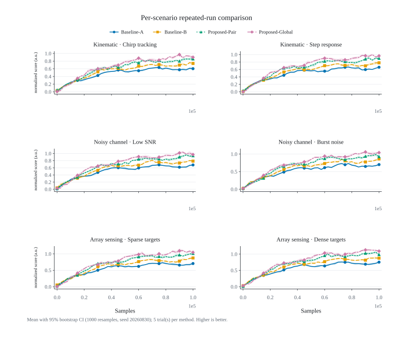

# 信号实验图工作台（Signal figure studio）

[English](README.md) | 中文

**DeepSeek Harness 插件**：把信号处理论文实验部分的重复运行日志变成可发表插图。选择实验图类型，在实时
预览上调整排版与配色，多轮迭代并随时回滚。

[](LICENSE)
[](https://github.com/jiesudd/dsh-signal-figure-studio/actions/workflows/checks.yml)



## 为什么做这个

信号处理论文的实验部分反复出现同样五类图：逐场景曲线、稳健聚合、消融、敏感性、机制分析。手工重画很容易
出现这些问题：不确定性从不交代、把 dB 值当线性值平均、负误差用零基线柱状图、各面板配色不一致、以及"改进"
无法复现，因为绘图脚本被就地改掉了。

这个插件把一条证据链固化下来：日志先审计再画图；统计量只算一次并固定随机种子；排版与配色是**保存的规格**而
不是脚本改动；每一轮都是一个**版本**，可 diff、可对比、可回滚；图还会按十项验收标准打分。

## 功能

- **五种图型**：逐场景曲线、跨场景 IQM、消融、敏感性、机制；每种自动选用正确的数据子集与估计量。
- **实时预览**：画布尺寸、面板网格、间距、图例位置、字体与字号、调色板与逐方法取色、线宽/线型/标记、置信带
  或误差棒、网格与轴框、对数轴、刻度数、科学计数法、指标与单位、越高/越低越好、平滑窗口、检查点、dB 变换。
- **九个优化配方**：IEEE 单栏、双栏、幻灯片、色盲安全、提升对比、紧凑、放大字号、负 dB 修正、显示平滑；每次
  优化自动存版本。
- **版本历史与回滚**：每个版本带备注和字段级 diff（即回滚会改变什么），可并排对比；回滚本身也生成新版本，历史
  不会被覆盖；未保存的改动另有撤销/重做。
- **十项质检**：数据可追溯、重复次数、不确定性披露、稳健聚合、统计完整性、一致性、可读性、可访问性、可复现性、
  证据覆盖；18/20 为可发表线，前五项不得为 0。
- **导出**：矢量 SVG、按规格 dpi 栅格化的 PNG、端点汇总 CSV、规格 JSON、质检报告。
- **一套实现，两个调用方**：面板与 `signal_figure_studio` agent 工具调用同一个 Host 服务，不会各写一套。

## 环境要求

- 已安装的 DeepSeek Harness（Desktop 或 `dsh web`）及其 profile。
- Node.js ≥ 20（DSH 自带；本插件不安装任何依赖）。
- 从 GitHub 安装时才需要 Git。

## 安装

三种方式任选其一，安装的都是同一个 bundle，都进入你当前的 profile。

### 1. 插件页面（不用命令行）

1. 在 DSH 网页侧边栏打开 **Plugins（插件）**。
2. 点击 **Add plugin（添加插件）**。
3. 在包名输入框粘贴：

   ```
   github:jiesudd/dsh-signal-figure-studio
   ```

   或者完整的仓库地址：

   ```
   https://github.com/jiesudd/dsh-signal-figure-studio
   ```

4. 点击 **Install（安装）**。对话框会先读取该 spec，再运行 pnpm 并显示输出。
5. 完成后点击 **Enable now（立即启用）**。
6. 若页面此前已打开，刷新一次，侧边栏面板区就会出现 **信号实验图工作台**。

安装前管理器会先对 GitHub 执行 `git ls-remote` 检查，所以 **`PATH` 中必须有 Git**；没有 Git 会在这个检查处
失败，而不是在下载时失败。

### 2. 让 agent 安装

```
plugin_manager { action: "install_bundle", target: "github:jiesudd/dsh-signal-figure-studio" }
```

### 3. 从本地检出安装（开发用）

```bash
git clone https://github.com/jiesudd/dsh-signal-figure-studio.git
```

然后在 Harness 会话中让 agent 执行：

```
plugin_manager { action: "install_bundle", target: "<检出的绝对路径>" }
```

插件会以**链接**方式装入 profile，之后修改源码并重载插件即可生效。这条路径除了 clone 本身之外不需要
`git ls-remote` 检查。

### 环境要求

| 要求 | 原因 |
| --- | --- |
| 已安装的 DSH（Desktop 或 `dsh web`）且有可用 profile | bundle 装进 profile |
| Node.js ≥ 20 | DSH 运行时自带 |
| `PATH` 中有 Git | 仅 GitHub 路径需要（用于 `git ls-remote` 预检） |
| 无其他依赖 | 本插件没有依赖，也不跑安装脚本 |

### GitHub 路径失败时

| 现象 | 原因与处理 |
| --- | --- |
| 还没开始下载就失败，提示 GitHub 不可达 | `git ls-remote` 连不上 GitHub。切换到 npm 镜像**没用**——镜像只提供 registry 包，不提供 Git 仓库。改用方式 3，或把 `pnpm pack` 生成的 tarball 放到可访问的位置再安装。 |
| `already-installed` | profile 里已有同名的包。先卸载再装；版本切换就是"卸载 + 重装"。 |
| 安装成功但看不到面板 | 页面跨过了插件加载。刷新一次即可。 |
| 安装成功、bundle 加载了，但面板报错 | 浏览器控制台搜 `slot entry crashed`，连同 DSH 版本一起反馈。 |

> 包名保留了 `@local/` 前缀，这是本地开发沿用的名字。从 GitHub 安装与解析都正常工作。若你打算发布到
> npm，请同时修改 `package.json` 与 `cordis.patch.yml` 里的 `name`，然后重新安装。

## 快速上手

1. 点击侧边栏面板图标。
2. 点「载入演示数据」体验（合成数据，已明确标注），或「导入 CSV」加载真实整洁日志。
3. 左侧选择图类型。
4. 右侧调整排版与配色，预览实时更新。
5. 用「优化」套用论文风格，用「保存版本」记录自己的检查点，用「对比」查看历史版本，然后「回滚」。
6. 导出 SVG/PNG 以及汇总 CSV、规格 JSON、质检报告。

## 数据契约

整洁 CSV，一行一个观测：

```csv
benchmark,scenario,method,seed,step,value,metric,unit,variant,heterogeneity
ANC,Impulse,NLMS,0,0,-15.563,error power,dB,main,
```

必需列：`benchmark, scenario, method, seed, step, value`；可选列：`metric, unit, variant, heterogeneity`。
`variant` 用于区分 `main` / `ablation` / `sensitivity`，`heterogeneity` 供机制图使用。

导入即审计，以下情况**阻止出图**并给出行号，而不是静默丢弃：

- 重复的 `(benchmark, scenario, method, seed, step)` 键；
- 非有限的数值或步长；
- 同一 run 内步长非单调；
- 重复次数少于 3；
- 同一场景内步网格不一致。

## 图类型

| 类型 | 适用场景 | 统计量 |
| --- | --- | --- |
| 逐场景曲线 | 共享步网格的重复运行，一场景一面板 | 均值 + 95% 自助置信带 |
| 跨场景 IQM | 每个 benchmark 有多个场景，检查点上的样本效率 | 四分位均值 + 分层自助置信区间 |
| 消融 | 确实变化了组件/策略因子（`variant=ablation`） | 逐方法均值 + 置信带 |
| 敏感性 | 确实变化了超参数（`variant=sensitivity`） | 设置曲线，基线单独区分 |
| 机制 | 测量了机制变量（`heterogeneity`） | 机制均值 vs 性能均值 |

## 统计底线

- 区间是固定种子的百分位自助区间，重采样次数与种子会打印在图注里。
- 平滑是因果的，仅用于显示；端点与汇总表始终来自未平滑聚合。
- 线性存储的功率类指标在线性域聚合后才转 dB（功率用 `10·log10`，幅度用 `20·log10`）。
- 负 dB 比较使用带区间的曲线，默认打印「越低越好」。
- 默认不强制包含 0，避免负 dB 范围被压扁。

## 版本与回滚

版本是整个图规格的快照。「保存版本」带备注保存当前规格，「优化」会自动保存。历史面板列出每个版本的字段级
diff，也就是回滚到它会改变什么。回滚会恢复该规格并**再记一个新版本**，所以你随时可以回到回滚前的位置；未保存
的编辑还有撤销/重做。

## 架构

```
index.js        Host 端：注册 agent 工具与一个同源路由
lib/data.js     CSV 解析、日志审计、自助/IQM 统计、图数据
lib/spec.js     规格默认值、调色板、配方、质检评分
lib/render.js   确定性 SVG 渲染器（不依赖 canvas 或无头浏览器）
lib/studio.js   面板与工具共用的操作
lib/store.js    原子写入的项目存储（<DSH_HOME>/storages/）
client.js       Client 端：模块加载器工厂渲染的面板
```

图由专用的小型 SVG 引擎绘制，因此在任何机器上产出完全相同的字节，不需要 Python、matplotlib 或浏览器。

## 开发与测试

```bash
node test/smoke.mjs     # 或 npm test
```

冒烟测试会审计合成演示数据、渲染五种图型与九个配方、检查非有限坐标与未闭合 SVG、校验汇总表，并断言畸形日志
被拒绝。无需安装依赖。

## 限制

- 自研 SVG 引擎，不是 matplotlib：不支持 LaTeX 数学公式、嵌套分面、3D 图。
- 输出 SVG 与 PNG；若期刊要求 PDF，请用自己的工具链转换。
- 日志必须已是整洁格式，宽表需先重塑。
- 内置演示数据为合成数据，不可作为证据。
- 两套调色板针对浅色背景调校，深色模式使用另一组色相。

## 许可证

[MIT](LICENSE) © 2026 jiesudd

本插件实现的流程（日志审计、IQM 聚合、验收检查）源自 `research-signal-figure-workflow` 技能。
